# Retail Recommendation System

Мини-рекомендательная система для e-commerce. 

Цель (условная):

Создать сервис, который будет оценивать вероятность покупки товара.

Выполнена модернизация базового ML-сервиса интернет-магазина в MLOps-систему с оркестрацией данных, 
отслеживанием экспериментов, автоматизированными проверками и инфраструктурой мониторинга.


## Реализованные задачи и результаты

### 1. Качество ML-модели — прогнозирование вероятности покупки

**Задача:** обеспечить адекватную оценку вероятности покупки товара на основе пользовательских событий, характеристик товаров и контекстных признаков.

**Техническое решение:**

| Компонент | Реализация | Назначение |
|---|---|---|
| ML Algorithm | CatBoost | Бинарная классификация: вероятность покупки |
| Data Splitting | Train / Validation / Test | Объективная оценка качества модели |
| Hyperparameter Optimization | Optuna | Поиск оптимальных гиперпараметров |
| Model Evaluation | PR-AUC, ROC-AUC | Контроль качества прогнозирования |
| Experiment Tracking | ClearML | Логирование параметров, метрик и артефактов |

**Результаты обучения:**

| Метрика | Значение |
|---|---:|
| Validation PR-AUC | 0.040429 |
| Test PR-AUC | 0.037002 |
| Test ROC-AUC | 0.773481 |

**Где реализовано:**

| Артефакт | Расположение | Назначение |
|---|---|---|
| ML Training Pipeline | `src/ml/clearml_pipeline.py` | Обучение CatBoost и подбор гиперпараметров |
| Dataset Splitting | `src/ml/split_dataset.py` | Разделение на train, validation и test |
| Model Quality Tests | `tests/model_quality/` | Автоматические проверки качества |
| Experiment Tracking | ClearML UI | Метрики, параметры и артефакты эксперимента |

**Experiment ID:**

`bea847b4f7564004a4e1100ef5516680`

**Проверка качества модели:**

```bash
uv run --no-sync pytest tests/model_quality/ -q
```

**Evidence:**

- ClearML Experiment со статусом `Completed`.
- Вкладка `Artifacts` с результатами обучения.
- GitHub Actions CI #18 - `Model Quality: Success`.

**Оценка результата:** модель обучена, метрики рассчитаны и эксперимент зарегистрирован в ClearML. Для оценки бизнес-эффекта дополнительно необходимы baseline-сравнение, precision/recall и проверка рекомендаций на реальных пользовательских сценариях.

**Статус:** ML Pipeline реализован, обучение и оценка качества подтверждены.


**Статус Completed, Experiment ID**
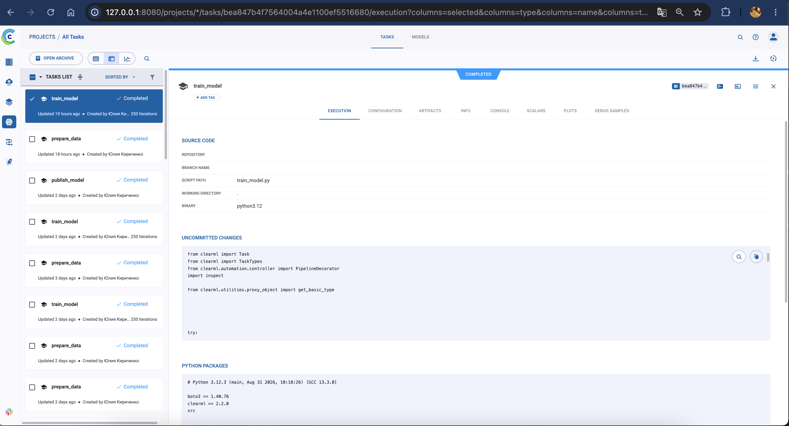

**Метрики модели**
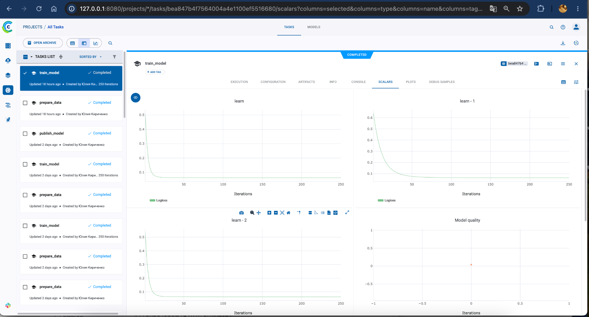

**ClearML: артефакты обучения**

В ClearML сохранён артефакт `training_results`, в нем
отображены лучшие гиперпараметры Optuna и итоговые метрики обучения
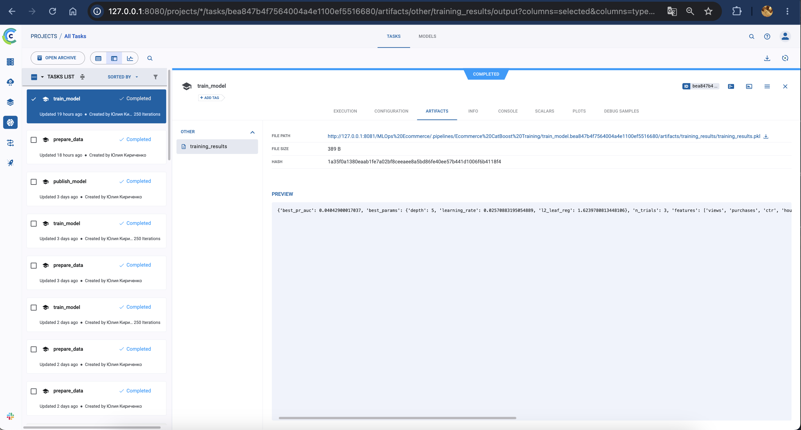


**Успешная проверка Model Quality в GitHub Actions**
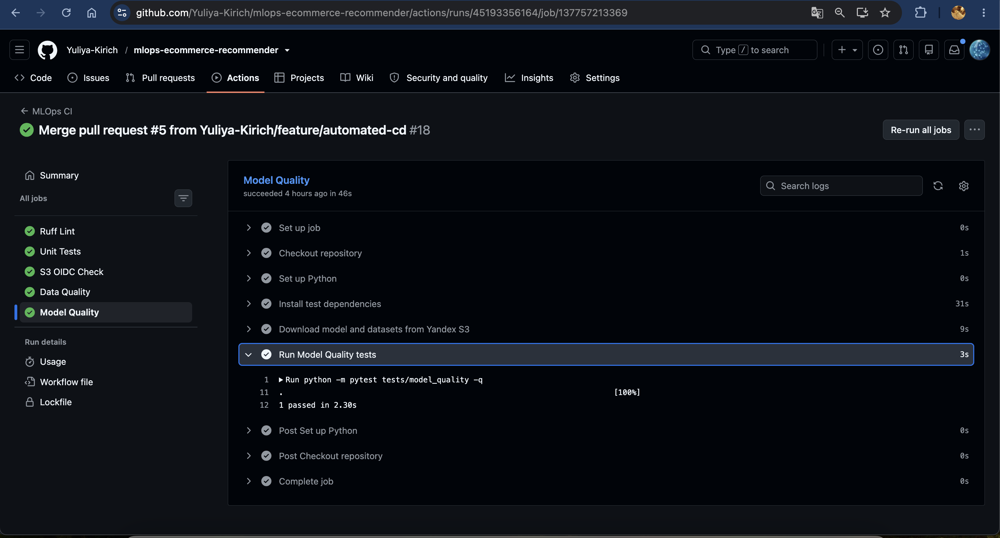


### 2. Стабильная работа inference-сервиса

#### Healthcheck — проверка доступности inference-сервиса

Для развёртывания inference-сервиса используется виртуальная
машина Yandex Cloud с контейнеризацией через Docker.

В инфраструктуре запущены:

| Компонент | Реализация | Назначение |
|---|---|---|
| Primary API | `ecommerce-purchase-api` | Основной inference-сервис |
| API Replica | `ecommerce-purchase-api-replica2` | Дополнительный экземпляр API |
| Reverse Proxy | `ecommerce-nginx` | Маршрутизация HTTP-трафика |
| Monitoring API | `ecommerce-purchase-api-monitoring` | Дополнительный сервис мониторинга |
| Metrics | `mlops-prometheus` | Сбор технических метрик |
| Visualization | `mlops-grafana` | Визуализация метрик |
| Alerting | `mlops-alertmanager` | Инфраструктура уведомлений |

На момент проверки контейнеры находились в состоянии
`Up 20 hours`.

**Evidence - Docker Runtime:**
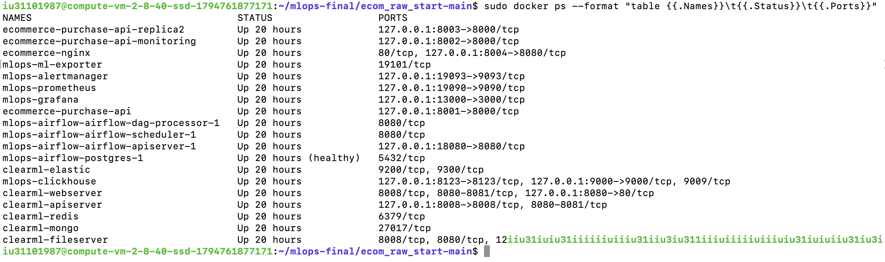


Выполнены HTTP smoke tests для FastAPI и nginx reverse proxy.

| Компонент | Endpoint | HTTP Status | Model Loaded |
|---|---|---|---|
| FastAPI | `http://127.0.0.1:8001/health` | 200 OK | true |
| nginx Reverse Proxy | `http://127.0.0.1:8004/health` | 200 OK | true |

**Результат:** inference API доступен напрямую и через nginx.
Приложение подтверждает успешную загрузку ML-модели.
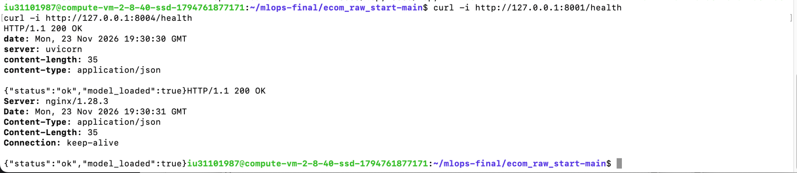

#### Online Inference — API Smoke Test

Проверена работоспособность inference API на виртуальной машине
Yandex Cloud.

**Endpoint:** `POST /predict_purchase`

**Тестовый запрос:**

```bash
curl -i -X POST "http://127.0.0.1:8001/predict_purchase" \
  -H "Content-Type: application/json" \
  -d '{"views":100,"purchases":5,"ctr":0.05,"categoryid":10,"available":1,"hour":14,"weekday":3}'
```

**Результат:**

| Показатель | Значение |
|---|---|
| HTTP Status | `200 OK` |
| Purchase Probability | `0.0407766682372495` |
| Model Version | `185d705e5d4c4c34ac74c05f7544e9e3` |
| Inference | Success |

Сервис успешно обработал POST-запрос и вернул прогноз
вероятности покупки товара.

**Evidence:**
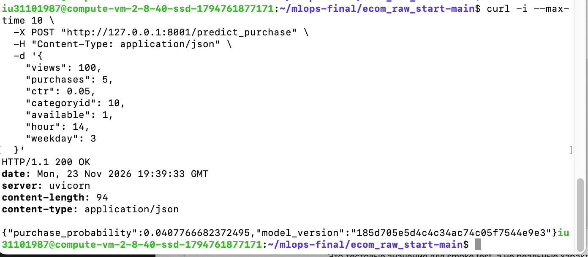

#### Inference через nginx Reverse Proxy

**Задача:** обеспечить доступ к ML inference-сервису через
единый HTTP entry point.

**Техническое решение:**

В качестве Reverse Proxy используется nginx, который
маршрутизирует HTTP-запросы к контейнеризированному
FastAPI inference-сервису.

**Проверка:**

```bash
curl -i --max-time 10 \
  -X POST "http://127.0.0.1:8004/predict_purchase" \
  -H "Content-Type: application/json" \
  -d '{"views":100,"purchases":5,"ctr":0.05,"categoryid":10,"available":1,"hour":14,"weekday":3}'
```

**Результаты smoke test:**

| Показатель | Результат |
|---|---|
| Endpoint | `POST /predict_purchase` |
| Entry Point | `http://127.0.0.1:8004` |
| Reverse Proxy | nginx 1.28.3 |
| HTTP Status | `200 OK` |
| Purchase Probability | `0.0407766682372495` |
| Model Version | `185d705e5d4c4c34ac74c05f7544e9e3` |
| Request Path | Client → nginx → FastAPI → Model |

**Evidence — nginx Inference:**
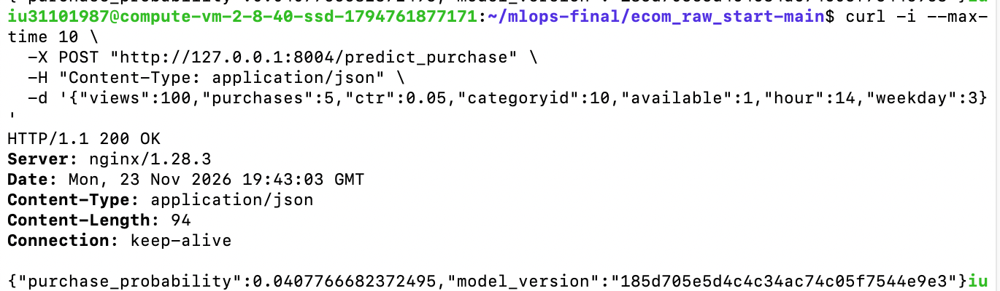


**Вывод:** подтверждена успешная обработка inference-запроса
через nginx Reverse Proxy. Результат совпадает с прямым
обращением к FastAPI на порту 8001.

Проверка подтверждает работоспособность HTTP-маршрутизации
и ML inference, но не является измерением SLA или
отказоустойчивости под нагрузкой.


### Надёжность inference API - Recovery Test

**Цель:** проверить автоматическое восстановление ML inference-сервиса после аварийного завершения основного процесса приложения.

**Инфраструктура:**
- Docker + Uvicorn
- Restart policy: `unless-stopped`
- Healthcheck: `GET /health`
- Мониторинг: Prometheus + Grafana

### Сценарий тестирования

Основной процесс Uvicorn был принудительно завершён сигналом `SIGKILL`, направленным на его PID на хосте.

### Результаты

| Показатель | До теста | После восстановления |
|---|---|---|
| Docker Restart Count | 0 | 1 |
| Container Status | Running | Running |
| Healthcheck | — | HTTP 200 |
| Model Loaded | — | `true` |
| Recovery | — | Automatic |

API снова стал доступен к третьей попытке проверки `/health`. Точное время восстановления не измерялось.

### Вывод

Подтверждено автоматическое восстановление контейнера Docker после неожиданного завершения основного процесса Uvicorn.

Тест демонстрирует **process-level recovery** и повышает уверенность в способности сервиса восстанавливаться после локальных сбоев.

**Ограничения:** восстановление после отказа виртуальной машины, сетевых сбоев и недоступности облачного хранилища не проверялось. Доступность на уровне SLA 99% не измерялась. Переключение трафика между экземплярами при отказе отдельно не тестировалось.


### 4. Мониторинг ML-модели и inference-сервиса

**Задача:** обеспечить наблюдаемость (observability) ML-сервиса,
контроль доступности, производительности и поведения модели.

**Техническое решение:**

| Компонент | Технология | Назначение |
|---|---|---|
| Metrics Collection | Prometheus | Сбор метрик сервиса |
| Visualization | Grafana | Дашборды технических и ML-метрик |
| Alerting Infrastructure | Alertmanager | Обработка уведомлений |
| ML Metrics Export | ML Exporter | Экспорт метрик модели |
| Inference Runtime | FastAPI + Docker | Источник метрик |

**Расположение:**

- Prometheus: `http://127.0.0.1:19090`
- Grafana: `http://127.0.0.1:13000`
- Alertmanager: `http://127.0.0.1:19093`

#### Prometheus - Monitoring Targets
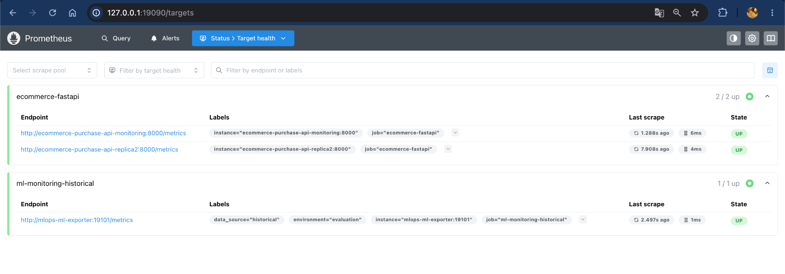


**Grafana - Inference Monitoring Dashboard**
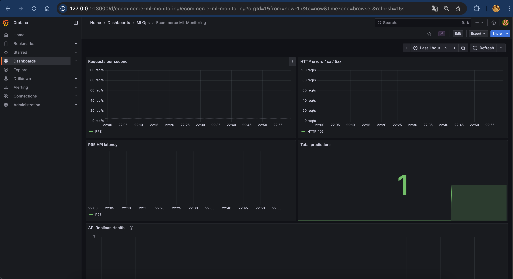

#### Model Monitoring
**ML Quality Monitoring**
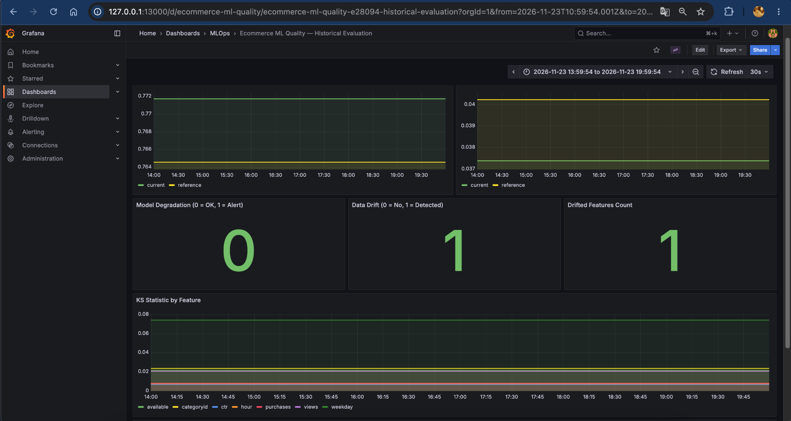

**Data Drift & Metrics Freshness**
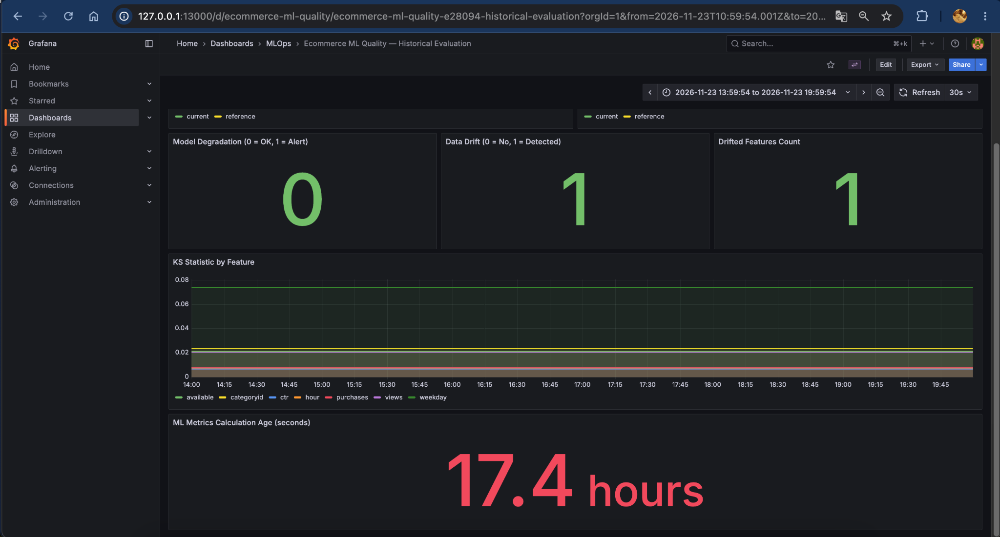


#### Alerting
**Техническое решение:**

В инфраструктуре настроены Prometheus Alert Rules,
отображаемые в Grafana Alerting.

Правила определены в конфигурационном файле
`/etc/prometheus/alert_rules.yml`.

**Реализованные правила:**

| Alert Rule | Назначение | Состояние |
|---|---|---|
| `FastAPIReplicaDown` | Недоступность отдельной реплики FastAPI | Normal |
| `FastAPIAllReplicasDown` | Недоступность всех реплик API | Normal |
| `MLModelDegradation` | Деградация качества ML-модели | Normal |
| `MLDataDriftDetected` | Обнаружение Data Drift | Normal |
| `MLMonitoringStale` | Устаревание ML-метрик | Normal |

**Результат проверки:**

- Configured Alert Rules: 5.
- Rule Health: OK.
- Current State: 5 Normal.
- Alert Source: Prometheus.

**Evidence - Grafana Alert Rules:**
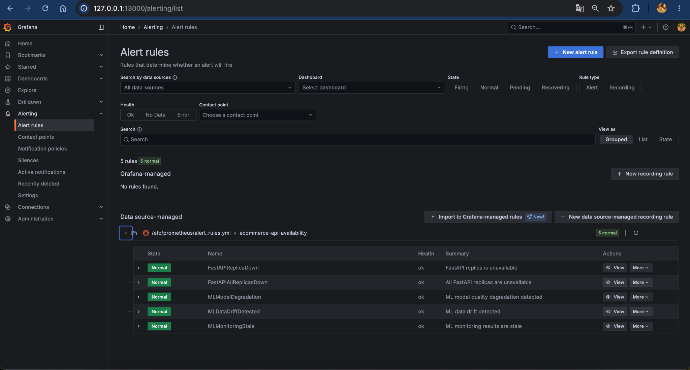


### 5. Версионирование исходного кода и CI/CD

**Задача:** обеспечить централизованное хранение исходного кода,
контроль изменений и автоматическую проверку качества.

**Техническое решение:**

В проекте используется Git в качестве системы контроля версий.
Основной удалённый репозиторий размещён на GitHub.

Для разработки применяется Feature Branch Workflow:
изменения создаются в отдельных ветках, проверяются
через Pull Request и объединяются с основной веткой `main`.

**Repository:**

https://github.com/Yuliya-Kirich/mlops-ecommerce-recommender

**CI/CD Infrastructure:**

| Компонент | Реализация | Назначение |
|---|---|---|
| Source Control | Git / GitHub | Версионирование кода |
| Main Branch | `main` | Основная версия проекта |
| Feature Branch | `feature/automated-cd` | Изолированная разработка |
| Pull Request | PR #5 | Контролируемый merge |
| CI Pipeline | GitHub Actions | Автоматические проверки |
| GitLab CI Config | `.gitlab-ci.yml` | Альтернативная CI-конфигурация |
| CD Workflow | `.github/workflows/cd.yml` | Подготовленная автоматизация CD |

**Результат:**

Pull Request #5 успешно объединён в ветку `main`.

Merge commit: `acb6265`.

GitHub Actions MLOps CI #18 завершился успешно.

| Quality Gate | Status |
|---|---|
| Ruff Lint | Passed |
| Unit Tests | Passed |
| S3 OIDC Check | Passed |
| Data Quality | Passed |
| Model Quality | Passed |

**Evidence - Repository:**
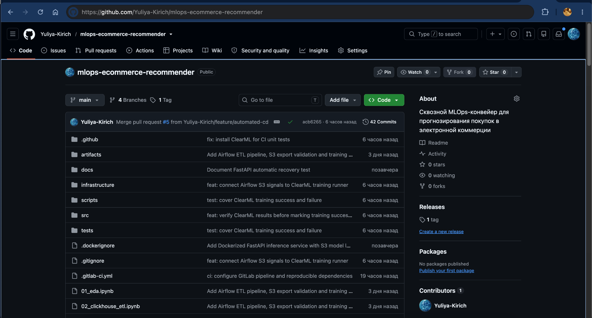


**Evidence - Pull Request:**
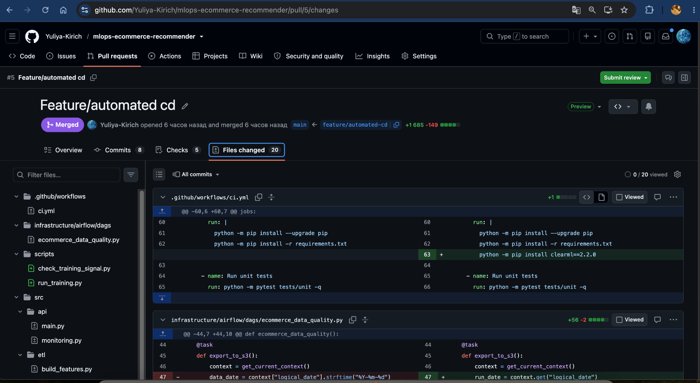

**Evidence - CI Pipeline:**
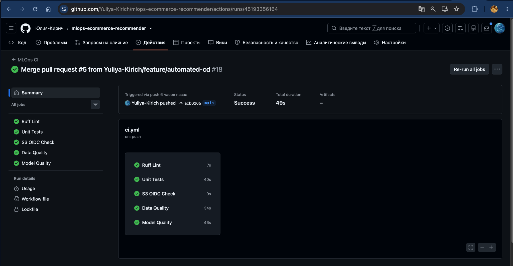

**Ограничение:** исходное задание предусматривало GitLab.
Фактически используемый репозиторий размещён на GitHub.
Конфигурация `.gitlab-ci.yml` присутствует, но её выполнение в GitLab не подтверждено. Production CD отключён.


### 6. Версионирование артефактов обучения - ClearML
**Задача:** обеспечить воспроизводимость ML-экспериментов,
трассируемость результатов обучения и хранение артефактов модели.

**Техническое решение:**

Для Experiment Tracking используется ClearML.
Обучение реализовано на CatBoost с подбором
гиперпараметров через Optuna.

| Компонент | Реализация | Назначение |
|---|---|---|
| Experiment Tracking | ClearML | Регистрация ML-экспериментов |
| ML Pipeline | `src/ml/clearml_pipeline.py` | Обучение и подбор параметров |
| Hyperparameter Optimization | Optuna | Выбор лучших гиперпараметров |
| Model Evaluation | PR-AUC / ROC-AUC | Оценка качества модели |
| Training Artifacts | `training_results.pkl` | Сохранение результатов |
| Dataset Storage | Yandex Object Storage | Хранение версий датасетов |

**Подтверждённый эксперимент:**

| Параметр | Значение |
|---|---|
| Experiment Name | `train_model` |
| Task ID | `bea847b4f7564004a4e1100ef5516680` |
| Status | Completed |
| Artifact | `training_results.pkl` |
| Validation PR-AUC | 0.040429 |
| Test PR-AUC | 0.037002 |
| Test ROC-AUC | 0.773481 |
| Training Iterations | 250 |

#### Experiment Tracking

ClearML регистрирует эксперимент, его уникальный Task ID,
состояние выполнения и связанные артефакты.


#### Training Metrics

В ClearML сохраняются графики обучения CatBoost.
Динамика Logloss отображается на протяжении 250 итераций.


#### Training Artifacts

В ClearML File Server сохранён артефакт
`training_results.pkl`.

Артефакт содержит сведения о лучших гиперпараметрах Optuna,
метрике Validation PR-AUC и результатах обучения.

Для артефакта доступен хеш содержимого.


**Результат:** реализовано отслеживание ML-экспериментов
с уникальными идентификаторами, метриками,
параметрами и сохранёнными артефактами.

**Ограничение:** успешное сохранение результатов обучения
в ClearML подтверждено. Автоматическая публикация
лучшей модели в S3 и её перевод в production-статус
пока отдельно не подтверждены.

**Статус:** Experiment Tracking - реализовано и проверено.
Model Registry / Production Model Versioning -
требует дополнительного подтверждения.


### 7. Автоматизация подготовки данных - Apache Airflow

**Задача:** автоматизировать подготовку обучающих данных,
контроль их качества и передачу результатов в S3 для
последующего обучения ML-модели.

**Техническое решение:**

Реализован ETL-пайплайн на Apache Airflow 3.
Для формирования обучающего датасета используется ClickHouse.
Подготовленные данные экспортируются в Yandex Object Storage.

**DAG:** `ecommerce_data_quality`

**Расписание:** ежедневно в 06:00 UTC.

#### Архитектура Data Pipeline

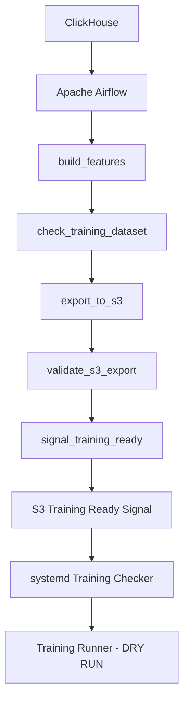

#### Pipeline Stages

| Этап | Airflow Task | Назначение |
|---|---|---|
| Feature Engineering | `build_features` | Формирование обучающих признаков |
| Data Quality Gate | `check_training_dataset` | Проверка датасета |
| Data Export | `export_to_s3` | Экспорт обучающей выборки |
| Export Validation | `validate_s3_export` | Проверка Parquet и manifest |
| Training Trigger | `signal_training_ready` | Создание сигнала готовности данных |

#### Где реализовано

| Компонент | Расположение |
|---|---|
| Airflow DAG | `infrastructure/airflow/dags/ecommerce_data_quality.py` |
| Feature Engineering | `src/etl/build_features.py` |
| Training Signal Checker | `scripts/check_training_signal.py` |
| Training Runner | `scripts/run_training.py` |
| Dataset Storage | Yandex Object Storage |
| Source Data Processing | ClickHouse |

#### Результаты обработки данных

| Показатель | Значение |
|---|---|
| Dataset | `training_dataset.parquet` |
| Records | 2 654 387 |
| File Size | 49 399 318 bytes |
| Data Date | `2026-11-22` |
| Storage | Yandex Object Storage |
| Metadata | `manifest.json` |
| Training Signal | `training_ready.json` |

**S3 Artifact Path:**

`s3://mlops-yk-2026/mlops-ecommerce/processed/date=2026-11-22/`

#### Автоматизация downstream-процесса

После проверки экспорта Airflow создаёт файл
`training_ready.json`.

Сервис `mlops-training-signal.service` проверяет
наличие новых сигналов каждые 10 минут через systemd timer.

Реализована защита от повторной обработки
одной версии датасета.

Текущий режим - DRY RUN: автоматическое обучение
не запускается.

#### Evidence - Airflow DAG


#### Evidence - Airflow Task Execution (DAG v6)

Успешный scheduled run от 23.11.2026: 4/4 задачи завершены успешно. В актуальной версии DAG v7 добавлена пятая задача `signal_training_ready`, её выполнение проверено отдельно.
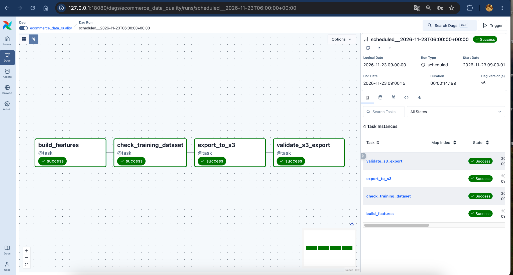


#### Evidence - S3 Data Artifacts


#### Evidence - Training Signal Automation


**Результат:** реализована автоматизация подготовки,
валидации и экспорта обучающего датасета.

Экспорт в S3 и формирование сигнала готовности проверены.
Полный успешный запуск всех пяти задач в рамках одного
DAG Run требует отдельного подтверждения.


### 8. Хранение обучающих артефактов в Yandex S3
**Задача:** обеспечить централизованное хранение,
логическое версионирование и воспроизводимое использование
датасетов для обучения ML-модели.

**Техническое решение:**

Для хранения обучающих данных используется
Yandex Object Storage с S3-совместимым API.

Apache Airflow экспортирует подготовленную выборку
из ClickHouse в формате Parquet.

Данные размещаются в отдельных префиксах по дате
формирования датасета.

#### S3 Storage Architecture

| Компонент | Реализация | Назначение |
|---|---|---|
| Object Storage | Yandex S3 | Централизованное хранение данных |
| Storage Bucket | `mlops-yk-2026` | Бакет проекта |
| Data Format | Apache Parquet | Хранение обучающей выборки |
| Dataset Versioning | `date=YYYY-MM-DD` | Разделение версий по датам |
| Export Metadata | `manifest.json` | Контроль состава и размера выгрузки |
| Training Trigger | `training_ready.json` | Сигнал готовности данных |
| Training Dataset Loader | `src/ml/split_dataset.py` | Загрузка и разделение датасета |

#### S3 Data Artifacts

**S3 Prefix:**

`s3://mlops-yk-2026/mlops-ecommerce/processed/date=2026-11-22/`

| Артефакт | Назначение |
|---|---|
| `training_dataset.parquet` | Обучающий датасет |
| `manifest.json` | Метаданные экспорта и контроль целостности |
| `training_ready.json` | Сигнал готовности версии датасета |

#### Dataset Statistics

| Показатель | Значение |
|---|---:|
| Dataset Records | 2 654 387 |
| Parquet Size | 49 399 318 bytes |
| Train Records | 2 107 085 |
| Validation Records | 263 486 |
| Test Records | 283 816 |
| Data Version | 2026-11-22 |

#### Dataset Lineage

Последовательность обработки данных:

`ClickHouse -> Airflow -> Data Quality Gate -> S3 Parquet -> ML Training`

Выполняется проверка количества строк,
размера файла и соответствия метаданных экспорта.

Признак готовности датасета передаётся через
объект `training_ready.json`.

#### Evidence - S3 Versioned Datasets


#### Evidence - S3 Training Artifacts


**Результат:** подтверждено хранение подготовленных
обучающих датасетов в Yandex Object Storage.

Реализована логическая идентификация версий датасетов
по дате выгрузки и контроль метаданных через manifest.

**Ограничение:** разделение объектов по датам не равнозначно
включённому S3 Object Versioning. Его наличие отдельно
не подтверждено.


---

## AS IS - исходные инструкции стартового репозитория (архив)

> Следующие команды и описания сохранены для сравнения с начальным состоянием проекта. Они **не являются** актуальной инструкцией по запуску production-инфраструктуры. В актуальном API используется POST-запрос с JSON, а не GET с параметром `itemid`.

Стартовый вариант работы с данными от команды Data Science:
  - обработка логов просмотров/покупок (prepare_features.py)
  - обучение CatBoost (train_model.py)
  - FastAPI сервис для инференса (main.py)


| Сценарий | Что делает сервис |
|---|---|
| Оценка вероятности покупки | Рассчитывает вероятность покупки товара на основе его характеристик и контекстных признаков |
| Online Inference | Возвращает прогноз через FastAPI `POST /predict_purchase` |
| Контроль доступности | Проверяет состояние API и загрузку модели через `/health` |
| Версионирование модели | Возвращает `model_version` вместе с предсказанием |
| Мониторинг | Отслеживает запросы, ошибки, задержки и показатели качества модели |


## Создание окружения

Официальная инструкция по установки uv: https://docs.astral.sh/uv/getting-started/installation/

```bash
uv --version               # проверить что uv установлен
uv venv .venv              # создать виртуальное окружение
source .venv/bin/activate  # активировать
uv pip install -r requirements.txt
```
---

## Шаг 1 - Подготовка фичей

 ⚠️ **Важно** здесь вы можете модифицировать код и изменить подход к генерации фичей.

```bash
python prepare_features.py
```


### Артефакты на этом шаге

| Файл                        | Описание          |
| --------------------------- | ----------------- | 
| `item_features.parquet`     | Фичи товаров      |
| `data_for_training.parquet` | Обучающая выборка |

---

## Шаг 2 - CatBoost модель

Подробнее об модели - https://catboost.ai/docs/en/

⚠️ 1. Необходимо будет выбрать наиболее оптимальные гиперпараметры. 

⚠️ 2. Вы можете выбрать другую модель для решения задачи.
```bash
python train_model.py
```

### Артефакт

| Файл         | Описание                                    |
|--------------|---------------------------------------------|
| `ranker.pkl` | Модель, предсказывающая вероятность покупки |

---

## Шаг 3 - Запуск FastAPI сервиса

 ⚠️ **Важно** здесь вы должны модифицировать логику работы FastAPI, чтобы можно было настроить мониторинг.

```bash
python3 main.py
```

API: http://127.0.0.1:32000
Swagger: http://127.0.0.1:32000/docs

Тестирование API:

Вероятность покупки
```bash
curl "http://127.0.0.1:32000/predict_purchase?itemid=356475&hour=14&weekday=3"
```

Healthcheck
```bash
curl http://127.0.0.1:32000/health
```

Смотрим текущую версию модели
```bash
curl http://127.0.0.1:32000/version
```

---

## Структура проекта

Ниже приведён пример структуры из исходного задания, а не фактическая структура текущего репозитория.

```
project-root/
│
├── config/ # Конфигурационные файлы (Prometheus, Grafana, k8s и др.)
│ ├── prometheus.yml
│ └── grafana/
│ └── k8s/
│
├── src/ # Исходный код приложения
│ ├── main.py
│ ├── utils.py
│ └── ...
│
├── tests/ # Unit- и интеграционные тесты
│ └── test_main.py
│
├── .gitlab-ci.yml # Файл CI/CD для автоматизации процессов
├── Dockerfile # Описание Docker-образа приложения
├── docker-compose.yaml # Оркестрация сервисов (при необходимости)
├── pyproject.toml # Зависимости, настройки ruff, mypy, pytest
├── build.sh # Скрипт для сборки проекта (если нужен)
└── README.md # Документация проекта - обязательно пишите как работает ваш сервис!
```

## Чек-лист подсказок для выполнения проекта

Исходный чек-лист задания (сохранён для справки; отметки ниже не отражают фактический статус проекта):

- [ ] **.gitlab-ci.yml**  
      ➡️ Проверьте конфигурацию CI/CD. Настройте автоматическую сборку и тестирование, чтобы всё работало без сбоев.

- [ ] **pyproject.toml**  
      ➡️ Настройте этот файл: пропишите параметры для проверки качества кода (`ruff`), тестирования (`pytest`) и статической типизации (`mypy`).

- [ ] **Unit-тесты**  
      ➡️ Напишите хотя бы несколько базовых unit-тестов, чтобы проверить, что ключевые части вашего кода работают корректно.

- [ ] **Ruff & Code style**  
      ➡️ Проверьте код с помощью `ruff`. Исправьте все ошибки форматирования и приведите стиль к требованиям PEP8 и стандарту `black`.

- [ ] **mypy & Аннотации типов**  
      ➡️ Запустите `mypy` и исправьте все ошибки. Проверьте, что типы данных явно указаны во всех функциях, где это требуется.

- [ ] **Работа с данными**  
      ➡️ Если ваши данные сейчас хранятся в проекте (например, `.csv` или `.parquet`), перепишите код так, чтобы использовать внешнее хранилище (например, S3).  
      ⚠️ _Данные не должны лежать в репозитории!_

- [ ] **Docker: подготовка к деплою**  
      ➡️ Напишите `Dockerfile` для сборки Docker-образа вашего приложения.

- [ ] **docker-compose.yaml (если деплой на ВМ)**  
      ➡️ Для развертывания приложения на виртуальной машине добавьте файл `docker-compose.yaml`.

- [ ] **Конфигурации для мониторинга и k8s**  
      ➡️ Для интеграции с Grafana, Prometheus или развёртывания в k8s подготовьте необходимые конфиги.

